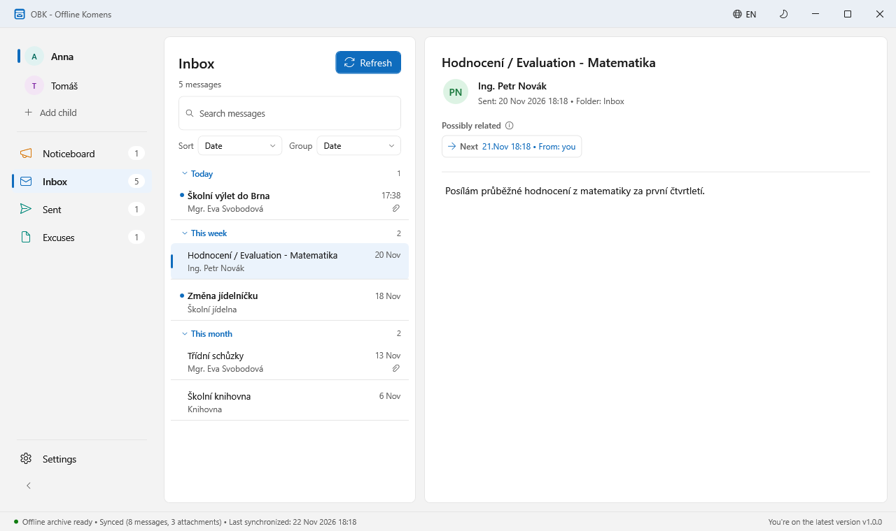
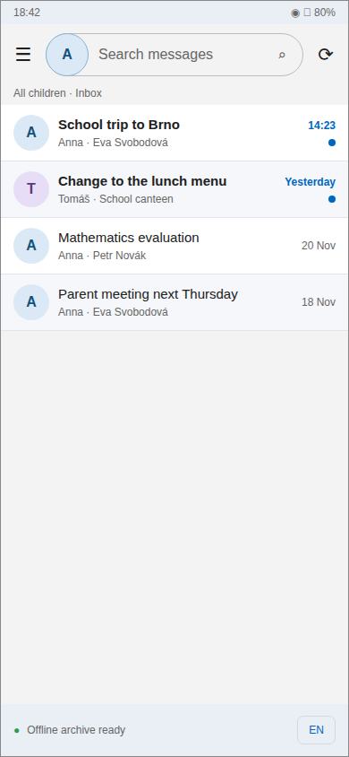

# OBK – Offline Bakaláři Komens

OBK downloads your children's **Bakaláři Komens** messages and attachments so
you can read, search, and organize them offline on Windows or Android.

| Windows | Android |
|:--:|:--:|
|  |  |

Documentation screenshots use fictional sample data.

## Contents

- [Features](#features)
- [Install](#install)
- [Getting started](#getting-started)
- [Privacy and security](#privacy-and-security)
- [License](#license)
- [More information](#more-information)

## Features

- [**All children and folders in one place**](docs/features/ACCOUNTS.md) –
  switch between children and schools, refresh every account, and browse
  Inbox, Noticeboard, Sent, and Excuses.
- [**Fast offline reading and organization**](docs/features/ORGANIZE.md) –
  search by subject, text, sender, or date; group and sort messages; follow
  likely related replies.
- [**Messages and attachments offline**](docs/features/OFFLINE.md) – keep
  downloaded content available without a school connection, then open or
  share attachments when needed.
- [**Comfortable on desktop and mobile**](docs/features/APPEARANCE.md) –
  light and dark themes, adjustable reading and list sizes, Czech/Ukrainian/
  German/English UI, and automatic Windows updates.

OBK is read-only. It cannot send messages, replies, excuses, or confirmations,
and it never marks a message as read on the school server.

## Install

- **[Windows](docs/WINDOWS.md)** – download and run the installer. The current
  Windows package is unsigned, so Windows may show a warning.
- **[Android preview](docs/ANDROID.md)** – download the APK from Releases or a
  preview workflow. Preview packages use development signing or are otherwise
  not distributed through a trusted store, so Android may show a warning.

See the platform pages before updating: changing from a development-signed
Android preview to a differently signed APK can require uninstalling the
preview and deleting its local archive.

## Getting started

1. On first start, search for your child's school (or enter its Bakaláři
   address), then sign in with your Komens username and password.
2. Optionally name the child and remember the password so **Refresh** can
   update that account without asking again.
3. Add more children or schools from the child/account controls.
4. Refresh to download new messages for every child.

OBK downloads the current school year (September–August). The interface
language defaults to a supported system language and can be changed in the app;
school messages are never translated.

On Android, you can avoid typing a saved Windows password by using **Settings >
Accounts > Transfer to Android** on Windows and **Scan from PC** on the phone.
The encrypted QR transfer is offline and works only while the three-word
confirmation is available in the Windows window.

## Privacy and security

### Privacy

- Your password is stored only when you choose to remember/save it.
- Messages and attachments travel directly between the app and the school's
  Bakaláři server over HTTPS. OBK does not send school data to its developer,
  GitHub, or an OBK cloud service.
- Update checks connect to GitHub Releases, separately from school traffic.
- OBK uses the same interface as the official Bakaláři mobile app. It is not
  an official Bakaláři product, and individual schools can disable that access.

### Security

- Cached messages, attachments, and remembered passwords are encrypted for the
  current Windows account or with Android Keystore-backed protection.
- Some database metadata, including a school address and username, is not
  encrypted. OS-level protection does not stop other software running under
  your account.
- Opening or exporting an attachment creates an unencrypted copy. Open only
  files you trust and remove unnecessary copies.
- Never include passwords or private messages in issue reports.

Windows releases currently remain unsigned while
[SignPath Foundation enrollment](docs/CODE_SIGNING.md) is pending. Android
preview signing and APK verification are described in the
[technical documentation](docs/TECHNICAL.md#android-release-signing).

For storage, encryption, synchronization, and threat-model details, see
[Windows desktop client](docs/TECHNICAL.md#windows-desktop-client) and
[Android preview](docs/TECHNICAL.md#android-preview).

## License

OBK-owned code is available under the [MIT license](LICENSE). Bundled
dependencies retain their own licenses and notices. This license does not grant
rights to Bakaláři software, school data, or API access; the service's applicable
terms still apply. OBK is not affiliated with or endorsed by Bakaláři.

## More information

- [Technical documentation](docs/TECHNICAL.md) – building, storage, security,
  synchronization, Android verification, and release process.
- [Code signing policy](docs/CODE_SIGNING.md) – signing responsibilities and
  release verification.
- [Deferred ideas](DEFERRED_IDEAS.md) – possible future work.
- [Report a problem](https://github.com/iricigor/OBK/issues) – do not include
  passwords or private message content.
