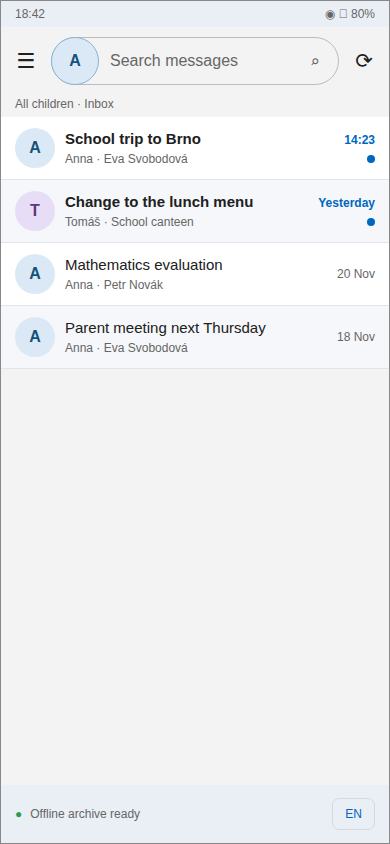

# OBK Android preview

[Back to README](../README.md#install)

The Android reader supports sign-in, multiple children, refresh, configurable background
checks with new-message notifications, offline folders and search, and opening or
sharing downloaded attachments. It requires Android 10 or later and is currently
a preview. Notification permission is requested only when you turn on
notifications in **Settings > Scheduled checks**.

## Marks

Choose **Marks** in the drawer.
Use its child button, search, and **Subjects / Recent marks** switch to browse;
tap an assessment for details. Marks have their own refresh and encrypted
offline snapshots. See [marks behavior and limitations](features/MARKS.md).

## Help and feedback

Tap **?** at the bottom right of the app, beside the language control.
The menu opens above the bottom bar, not in Android's system navigation bar.
**Get help** opens the [Android user guide](https://iricigor.github.io/OBK/android.html);
**Submit feedback / issue** opens GitHub's new-issue page in your external
browser. Tap outside the menu or press Back to dismiss it.

The help button has a 48 dp touch target and does not narrow the search field.
These links require an internet connection; they do not send school messages
or credentials. Never include private message content or passwords in feedback.
If no browser can open a link, OBK shows an error and leaves the reader usable.

## Install a release APK

1. Open the [latest release](https://github.com/iricigor/OBK/releases/latest)
   on the phone and download `OBK-<version>-android.apk`.
2. Open the downloaded APK. If Android asks, allow installation from that
   browser or file manager for this one installation.
3. Review the warning and confirm installation.

> **Preview signing:** Android preview APKs are development-signed, not signed
> by a trusted public app-store/release identity. Android may block them or show
> an unknown-app warning. Download only from the official repository; do not
> grant installation access to untrusted download sources generally.

Install a newer compatible release APK over the existing release app to keep
accounts and offline archives. The updater inside OBK verifies checksum,
package, version, and signing compatibility before opening Android's installer.

## Install a preview workflow artifact

Development-signed APKs from [Android preview runs](../.github/workflows/android-build.yml)
are intended for device verification, not production use. Installing a preview
built with a different key may require uninstalling the previous preview, which
deletes that preview's local archive and encryption key.

Do not uninstall a stable release merely to update it. If you move from a
development-signed preview to a release, first expect to set up accounts again
unless Android accepts the APK's signing identity as unchanged.

See [Android build and verification](TECHNICAL.md#android-preview) for
maintainer setup and [release signing](TECHNICAL.md#android-release-signing)
for stable distribution details.
