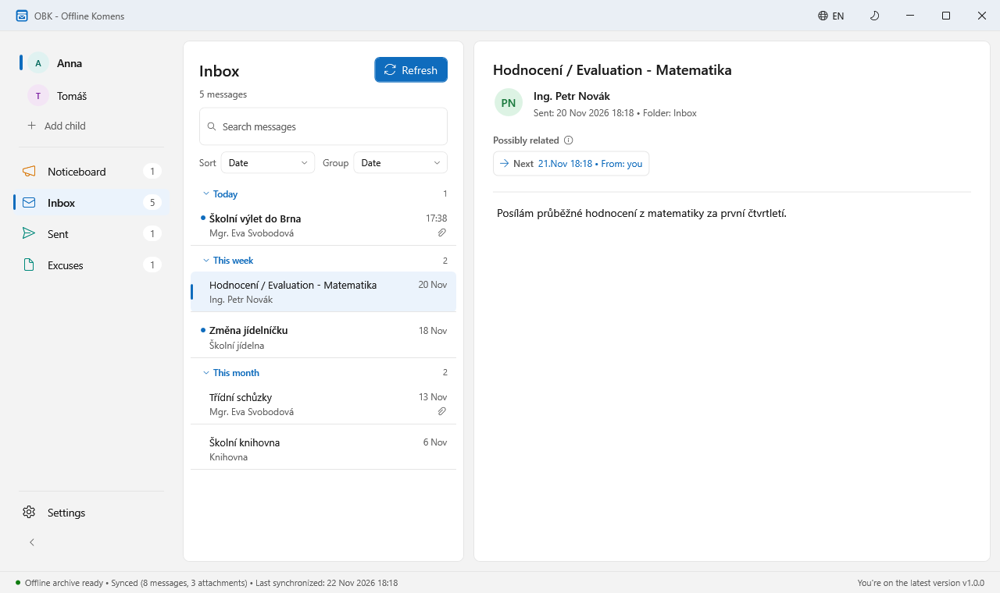

# OBK on Windows

[Back to README](../README.md#install)

## Install

1. Open the [latest release](https://github.com/iricigor/OBK/releases/latest).
2. Download `OBK-<version>-windows-x64-setup.exe`.
3. Run the installer and start **OBK** from the Start menu. Administrator
   rights and a separate .NET installation are not normally required.

OBK checks for updates while it runs and offers **Update and restart** when a
newer version is ready.

> **Unsigned package:** current Windows releases are not yet code-signed.
> SmartScreen or Windows may warn that the publisher is unknown. Download only
> from the official repository's Releases page, and check the published
> checksums and signing status before approving installation.

## Help and feedback

Select **?** at the bottom right of the main window, beside the version
indicator. The menu opens above the button: **Get help** opens the
[Windows user guide](https://iricigor.github.io/OBK/windows.html), and
**Submit feedback / issue** opens GitHub's new-issue page in your external
browser. The button also works with Tab and Enter or Space; use the arrow
keys to choose an action and Escape to dismiss the menu.

These links require an internet connection; they do not send school messages
or credentials. Never include private message content or passwords in feedback.
Browser-launch failures appear in OBK's status bar.

## Preview and source builds

The Actions [Windows workflow](../.github/workflows/windows-build.yml) produces
installer artifacts for pull-request verification. Source builds and packaging
instructions are in the
[technical documentation](TECHNICAL.md#windows-installer-and-releases).

Windows requires Windows 10 or later. To remove the app, uninstall **OBK** from
Windows **Apps > Installed apps**.
