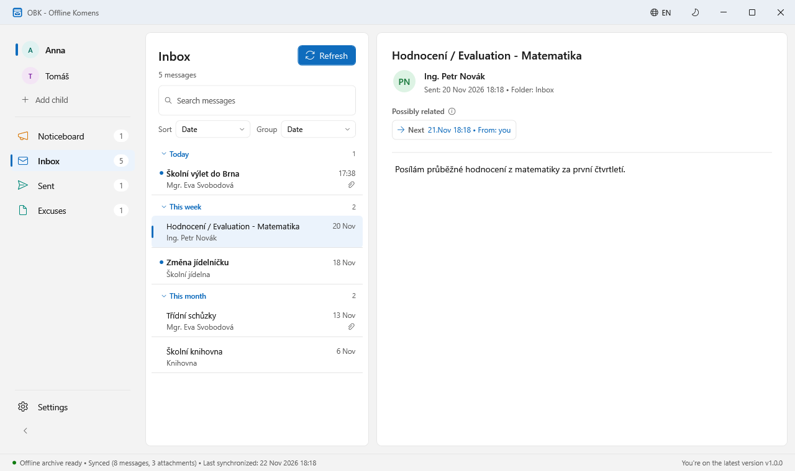
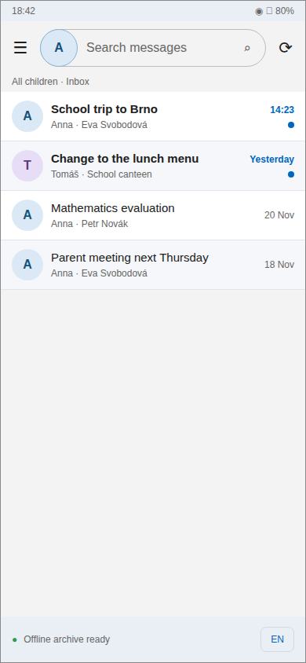

# Children and folders

[Back to README](../../README.md#features)

OBK keeps several children and schools in one archive. Choose one child or
**All children**, then move between Inbox, Noticeboard, Sent, and Excuses.
Refreshing from the main view updates every configured account. On Android,
optional hourly checks can also do this in the background and notify you about
new messages; Android asks for notification permission only when you turn
notifications on.

Account controls let you add or rename a child, save or forget a password, and
transfer a saved account securely from Windows to Android.

| Windows light | Android light |
|:--:|:--:|
|  |  |

OBK only reads Komens data. Folders are local views and do not change read or
delivery status on the school server.
