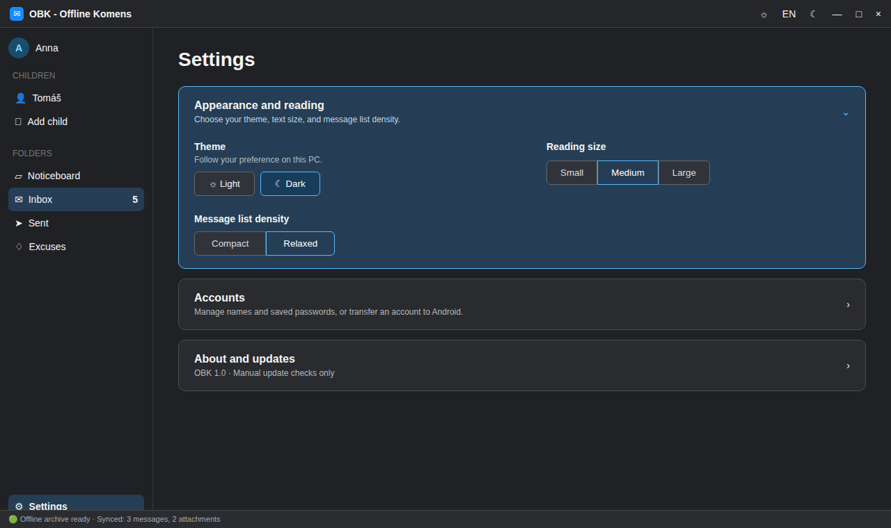
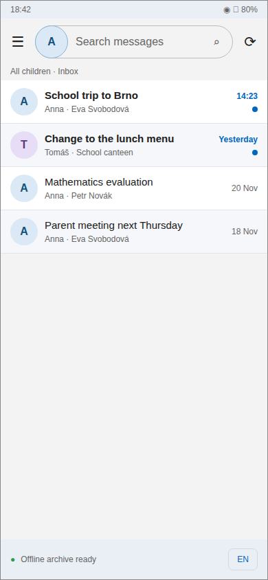

# Appearance and languages

[Back to README](../../README.md#features)

Windows and Android both offer light and dark themes, reading-size controls,
and compact or relaxed message lists. The sidebar can shrink to icons on
Windows, while Android keeps touch-friendly navigation and account controls.
On Android, the compact setting also fits the message header into two rows.

The interface is available in Czech, Ukrainian, German, and English. Language
selection can happen before sign-in and is remembered. Dates and numbers follow
the selected language, but school messages are not translated.

| Windows dark | Android light |
|:--:|:--:|
|  |  |
