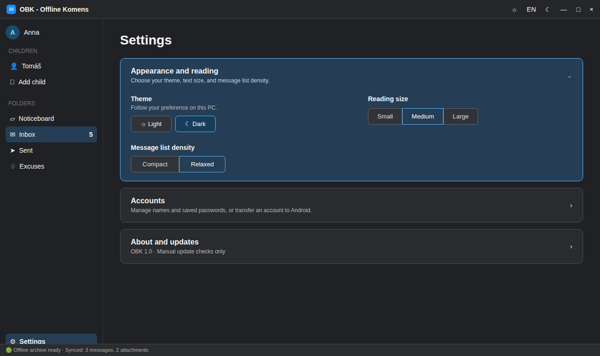
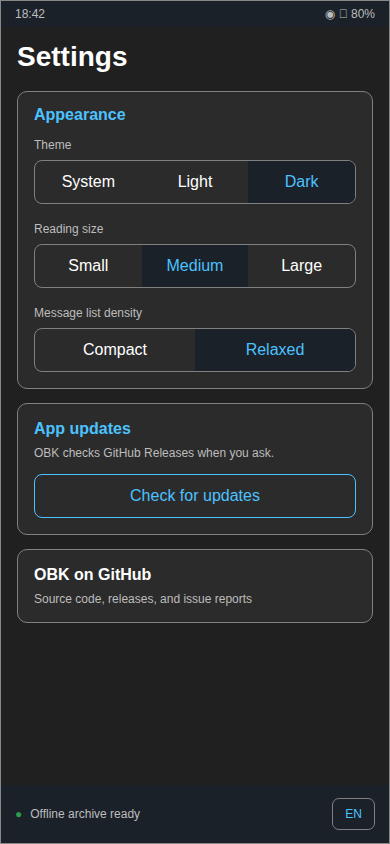

# Offline messages and attachments

[Back to README](../../README.md#features)

OBK stores downloaded messages and attachments locally, so searching and
reading continue without a school connection. Windows opens downloaded files;
Android can also share them with another installed app.

After sign-in, messages download before attachments. Once attachment downloads
start, you can explicitly choose to read messages while files continue downloading.
The bottom strip shows completed/total unique attachments and download details;
Android keeps it visible on both the message list and an open message.
Pending files cannot be opened or shared until their download is successfully
cached. A failed file download keeps the messages and already downloaded files;
retry sign-in or **Refresh** to download the missing files.

Background here means reading while OBK remains open, not downloads after closing
the app or guaranteed work while Android suspends it.

Opening or exporting an attachment creates an unencrypted file outside the app.
Use files only when you trust their source and delete unnecessary copies.

| Windows dark | Android dark |
|:--:|:--:|
|  |  |

Both apps remain read-only: an offline action cannot reply, send an excuse, or
confirm a school message.
