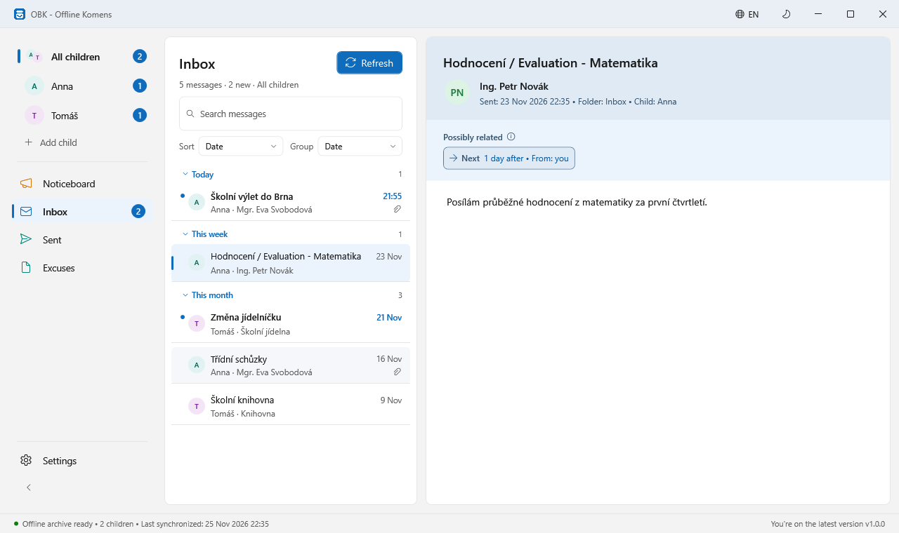
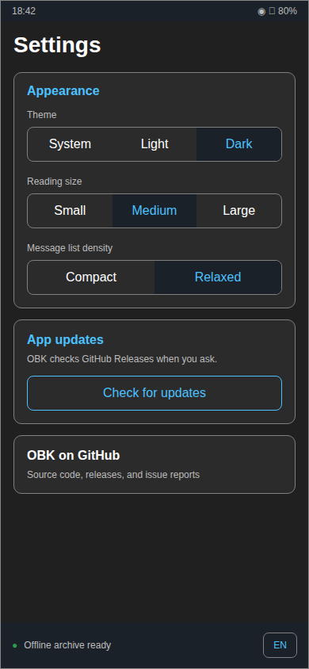

# Find and organize messages

[Back to README](../../README.md#features)

Search finds subject, message text, sender, and date without an internet
connection. Group by date, child, sender, or subject, and sort the results by
date, sender, or subject.

Likely earlier messages and replies are linked from the open message, labelled
with how many days apart they are. Both apps mark messages as new until they are
opened on that PC or phone; opening them in OBK never marks school-server
messages as read.

| Windows light | Android dark |
|:--:|:--:|
|  |  |
